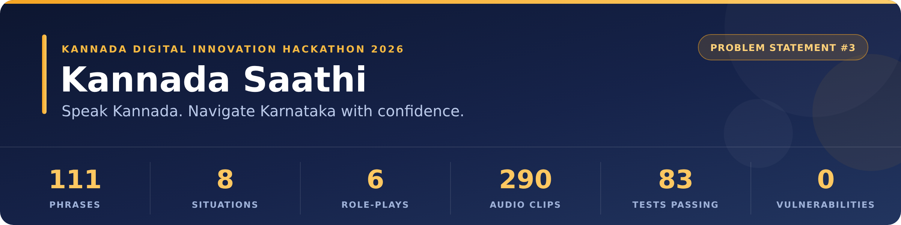
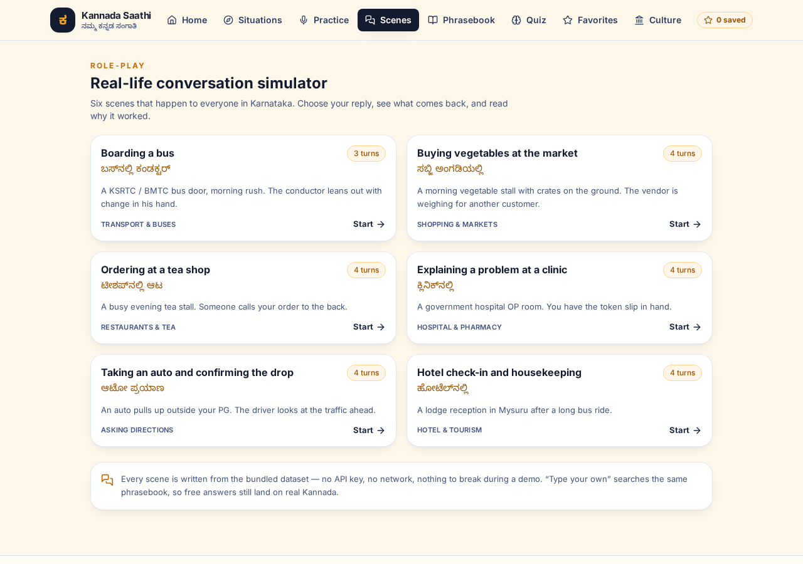
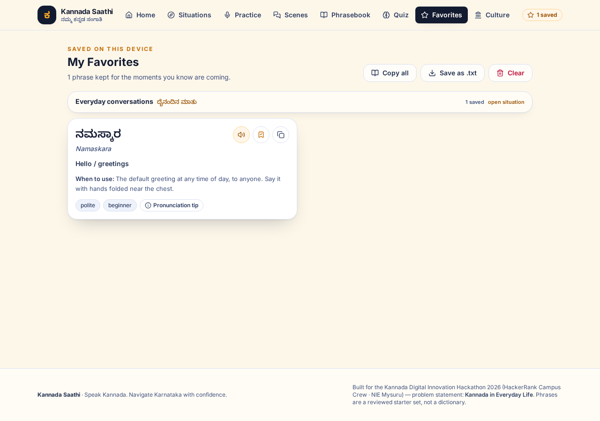
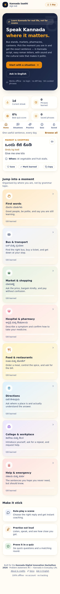
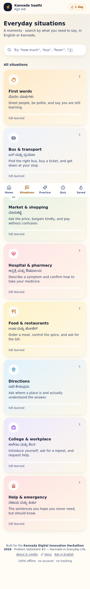
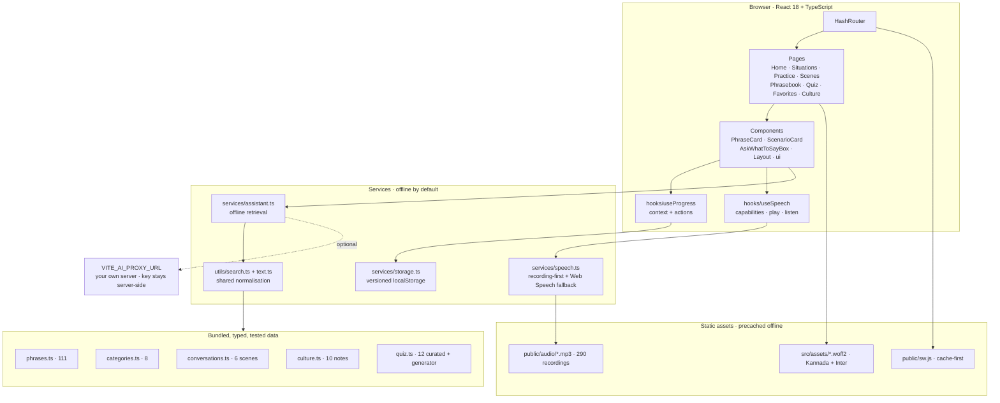

<div align="center">

<h1>ಕನ್ನಡ ಸಾಥಿ · Kannada Saathi</h1>

<p><strong>Speak Kannada. Navigate Karnataka with confidence.</strong></p>

<p>
  <a href="https://github.com/RANJITHROSAN17/Kannada-Digital/actions/workflows/ci.yml"></a>
  <a href="https://github.com/RANJITHROSAN17/Kannada-Digital/actions/workflows/deploy.yml"></a>
  <a href="docs/REVIEW.md"></a>
  <a href="docs/REVIEW.md"></a>
  <a href="LICENSE"></a>
  <a href="public/manifest.webmanifest"></a>
</p>

<p></p>

<p>
  <a href="https://ranjithrosan17.github.io/Kannada-Digital/"><strong>Live demo</strong></a> &nbsp;·&nbsp;
  <a href="https://github.com/RANJITHROSAN17/Kannada-Digital">Repository</a> &nbsp;·&nbsp;
  <a href="docs/Kannada-Saathi-Hackathon-Presentation.pdf">Presentation (PDF)</a> &nbsp;·&nbsp;
  <a href="docs/Kannada-Saathi-Demo-Video.mp4">Demo video</a> &nbsp;·&nbsp;
  <a href="docs/UNSTOP-FORM-ANSWERS.md">Unstop answers</a>
</p>

</div>

> **An offline-first, installable web app** that helps newcomers to Karnataka *say* the right thing at the right
> moment — at a bus stand, a pharmacy counter, a market or a canteen.
>
> Built for the **Kannada Digital Innovation Hackathon 2026** · HackerRank Campus Crew × NIE Mysuru
> **Problem Statement #3 — Kannada in Everyday Life** (#2 *Voice of Kannada* as a supporting capability).

---

## Status at a glance

| Check | Result | Verified by |
|:---|:---:|:---|
| CI — typecheck · 106 tests · build · audit | ✔ passing | [`.github/workflows/ci.yml`](.github/workflows/ci.yml) |
| GitHub Pages deployment | ✔ live | [`.github/workflows/deploy.yml`](.github/workflows/deploy.yml) |
| TypeScript (strict, `noUnusedLocals`) | ✔ 0 errors | `npm run typecheck` |
| Unit tests | ✔ 106 / 106 | `npm test` |
| `npm audit` (dev + production trees) | ✔ 0 vulnerabilities | CI gate |
| Chromium console / page / request errors | ✔ 0 | [`docs/REVIEW.md`](docs/REVIEW.md) |
| Speaker audio — online **and** offline | ✔ plays | 290 bundled MP3s + service worker |
| Third-party font / API requests at runtime | ✔ 0 | fonts, data and audio are bundled |

---

## Contents

| | | |
|:---|:---|:---|
| [1. Why this exists](#1-why-this-exists) | [2. See it](#2-see-it) | [3. Quick start](#3-quick-start) |
| [4. Deploy anywhere](#4-deploy-anywhere) | [5. Features](#5-features) | [6. Architecture](#6-architecture) |
| [7. Project layout](#7-project-layout) | [8. Dataset and review workflow](#8-dataset-and-review-workflow) | [9. Accessibility and responsiveness](#9-accessibility-and-responsiveness) |
| [10. Known limitations](#10-known-limitations) | [11. Tests](#11-tests) | [12. What the engineering review changed](#12-what-the-engineering-review-changed) |
| [13. Submission pack](#13-submission-pack) | [14. Stack](#14-stack) | [15. Licence and credits](#15-licence-and-credits) |

---

## 1. Why this exists

| Focus | Detail |
|:---|:---|
| **The problem** | People arriving in Karnataka for a job, a college seat, a hospital visit or a holiday can usually read English but cannot *say* anything useful in Kannada. Word-for-word translators give them nouns; what they need is a sentence, its sound, and the social tone that makes it land. Public signage, bus conductors, market vendors, pharmacy counters and government offices all run on spoken Kannada. |
| **Who is affected** | First-year students in Mysuru / Manipal / Bengaluru, transferred professionals, nurses and paramedics, domestic workers, shop owners serving new customers, tourists at Hampi / Coorg / Gokarna, and anyone accompanying a relative to a hospital appointment. |
| **The solution** | Kannada Saathi is organised **by the moment you are in**, not by vocabulary topic. Pick *Bus & transport*, *Hospital & pharmacy* or *Buying vegetables* and you get the exact sentences — in Kannada script, with a reader-friendly transliteration, the English meaning, when to use it, **bundled Kannada audio** that plays on any browser, and the cultural note that makes the sentence polite instead of blunt. Then rehearse it in a branching role-play and prove it in a quiz. |
| **Expected impact** | A learner who spends eight minutes in the app before stepping out can complete a real transaction — ask a price, board a bus, confirm a dosage — without switching to English or waving a phone. The starter set is reviewable and growable, so a native speaker can improve the app without touching code. |

### What makes it different

| Decision | What it means in practice |
|:---|:---|
| **Situation-first, not word-first** | Content is indexed by the pressure you are under, so retrieval at a counter takes one tap instead of a dictionary search. |
| **Honest capability reporting** | The app plays a real bundled recording even when the browser has no `kn-IN` voice, reports recognition gaps honestly, and refuses to display a pronunciation score it cannot compute. |
| **Role-play that explains** | A polite-but-wrong reply is answered and annotated, because that is what happens in real speech — the lesson is in the tone, not the vocabulary. |
| **Local-first, reviewable data** | No backend, no key, no third-party API call (audio is a same-origin static asset). Every phrase carries a review status, so a native speaker can audit the dataset in one file. |

---

## 2. See it

<table align="center">
  <tr>
    <td align="center"><br><sub>Home · progress, streak, phrase of the day</sub></td>
    <td align="center"><br><sub>Situations · 8 cards with per-card progress</sub></td>
    <td align="center"><br><sub>Phrasebook · search across script + transliteration</sub></td>
  </tr>
  <tr>
    <td align="center"><br><sub>Role-play · reply, coaching note, alternatives</sub></td>
    <td align="center"><br><sub>Scenes · 6 branching role-plays</sub></td>
    <td align="center"><br><sub>Voice practice · capability report + typed fallback</sub></td>
  </tr>
  <tr>
    <td align="center"><br><sub>Quiz · score, best kept, misses as review cards</sub></td>
    <td align="center"><br><sub>Offline "what do I say?" assistant · no API key</sub></td>
    <td align="center"><br><sub>Culture · politeness, register, regional variants</sub></td>
  </tr>
  <tr>
    <td align="center"><br><sub>Favourites · persisted in localStorage</sub></td>
    <td align="center"><br><sub>390 px · home</sub></td>
    <td align="center"><br><sub>390 px · situation detail</sub></td>
  </tr>
</table>

<div align="center"><sub>All captures come from the built app in Chromium at 1280 px and 390 px. Full set: <a href="docs/screenshots">docs/screenshots/</a></sub></div>

---

## 3. Quick start

Requires **Node 20.19+ or Node 22.12+** (Vite 8 requirement; CI uses Node 22). No backend, no API key, no account.

```bash
git clone https://github.com/RANJITHROSAN17/Kannada-Digital.git
cd Kannada-Digital
npm install
npm run dev          # http://localhost:5173
```

| Command | What it does |
|:---|:---|
| `npm run dev` | Vite dev server with HMR on `:5173` |
| `npm run typecheck` | `tsc --noEmit` — strict, no unused locals/parameters |
| `npm test` | Vitest — 83 tests across 7 files |
| `npm run build` | typecheck → `vite build` → generate the offline asset precache list |
| `npm run preview` | serve the built `dist/` on `:4173` |
| `npm audit` | 0 vulnerabilities (also enforced in CI) |
| `npm run test:watch` | watch mode |

<details>
<summary><strong>Try these five things in 60 seconds</strong></summary>

1. Open **Situations → Everyday conversations** and click the orange **speaker** on `ನಮಸ್ಕಾರ` — a real Kannada recording plays, even with no system TTS voice.
2. Type `fever` into the **Phrasebook** search — watch transliteration-tolerant ranking filter the dataset.
3. Ask the home-page **"What do I say?"** box `How much does this cost?` — it answers offline from bundled data.
4. Play the **bus conductor** scene and choose a *risky* reply — the coaching note explains why it lands badly.
5. Turn off the network, reload, and click the speaker again — the service worker serves the cached MP3.

</details>

<details>
<summary><strong>Full verification log (28 Oct 2026)</strong></summary>

```text
npm run typecheck  → 0 errors
npm test           → 83 passed, 7 files, ~7 s
npm run build      → 413.93 kB JS (123.78 kB gzip) · 37.11 kB CSS (7.31 kB gzip)
                     89 KB Kannada font + 48 KB Inter + 290 MP3s (4.9 MB)
npm audit          → 0 vulnerabilities (all / --omit=dev)

Chromium 156 @ 1280 px and 390 px, 10 routes:
  - exactly one <h1> per route, bundled fonts loaded (document.fonts.check === true)
  - 0 console / page / request errors, 0 external requests
  - every speaker control fetches /audio/kn-*.mp3 and plays it (paused=false, error=null)
  - offline reload renders and the speaker still plays from 298 precached URLs
  - full quiz round → matching round → result; favourites survive reload
  - offline assistant returns the right phrase; typed practice scoring works
```

Live site re-verified after deployment: `index` 200, `sw.js` 200 (cache `kannada-saathi-v4`),
`asset-precache.js` 200, `/audio/kn-0164.mp3` 206 `audio/mp3`,
and a real browser click played the clip with 0 errors.

</details>

---

## 4. Deploy anywhere

`HashRouter` + a relative `base: './'` means **any static host works with zero rewrite rules**, including a
sub-path.

| Host | Build command | Publish | Notes |
|:---|:---|:---|:---|
| **GitHub Pages** | `npm run build` | `dist/` via Actions | Push to `main`; enable *Settings → Pages → Source: GitHub Actions* once. **No env var needed.** |
| **Netlify** | `npm run build` | `dist` | [`netlify.toml`](netlify.toml) included; no env vars needed. |
| **Vercel / Cloudflare Pages** | `npm run build` | `dist` | Framework preset: Vite. No env vars needed. |
| **College LAN / nginx / any folder** | `npm run build` | copy `dist/` | Open `index.html`; deep links work through the hash router. |

Workflows: [`.github/workflows/ci.yml`](.github/workflows/ci.yml) gates every push and PR;
[`.github/workflows/deploy.yml`](.github/workflows/deploy.yml) publishes Pages.
Deployment notes and the push history live in [`docs/DEPLOY-FIX.md`](docs/DEPLOY-FIX.md).

---

## 5. Features

| # | Feature | Route | What actually works |
|:---:|:---|:---|:---|
| **A** | Situation-based assistant | `/situations`, `/situations/:id` | 8 situations, **111 phrases**, each with Kannada script · transliteration · English meaning · "when to use" · pronunciation tip · **bundled Kannada audio** · copy · bookmark. |
| **B** | Voice & pronunciation practice | `/practice` | "Hear the target" plays a real recording; capability dashboard; `SpeechRecognition (kn-IN)` where supported; typed fallback; text-similarity match; per-phrase practice log. |
| **C** | Conversation simulator | `/conversations`, `/conversations/:id` | 6 branching role-plays (bus conductor, vegetable market, tea shop, clinic, auto ride, hotel check-in). Every reply carries a coaching note, `risky` options are explained rather than failed, alternatives are offered, and free text resolves against the real dataset. |
| **D** | Searchable phrasebook | `/phrasebook`, `/favorites` | Ranked search over script + transliteration + meaning + keywords, situation filter, favourites-only filter, sort modes, recently viewed, favourites persisted in `localStorage`. |
| **E** | Learning & quiz | `/quiz` | 12 curated judgement questions + a generator over the dataset; 4 types (`en→kn`, `kn→en`, scenario, listening); pair-matching round; immediate feedback; best score kept; misses re-appear as review cards. |
| **F** | Regional & cultural context | `/culture`, inside each situation | 10 cultural notes, a regional-variant table where **every row is explicitly labelled as awaiting native review**, numbers/digits reference, and a public statement of the dataset's review status. |
| **G** | "What do I say?" assistant | home, situations | Ask in English, get ranked Kannada lines. Runs offline against the bundled data — and for any sentence the 111-phrase set does not contain (e.g. "what is the project status") offers a **live Kannada translation**, no API key. |
| **H** | Live bridge (ಸಂವಿಧಾನ) | home + `/bridge` | Speak English → the app plays the line as Kannada audio so the other person hears it in their language; their Kannada reply comes back translated and spoken in English. Recognition runs continuous (LiveBridge-style) and shows **live captions** — your words appear as you speak. Typed boxes keep the whole bridge usable without a mic, and every new sentence translates live (Google → MyMemory, no API key). |

<details>
<summary><strong>Deliberate non-claims</strong></summary>

* **No "pronunciation accuracy %"** — there is no reliable Kannada acoustic model in the browser, so the app
  reports **text similarity** and says so in the UI and in the code (`pronunciationAssessmentSupported()` → `false`).
* **No fake streaks or seeded stats.** Every number on the progress card derives from recorded interactions
  ([`src/utils/progress.ts`](src/utils/progress.ts)); a brand-new user legitimately sees zeros.
* **No invented dialects.** Regional variants are marked `needs-native-review` and rendered with a warning chip.
* **No dead buttons or placeholder pages.** Unknown routes redirect home; unknown situation/scene ids render an
  explicit "does not exist" state with a way back.

</details>

---

## 6. Architecture



**Data flow, in words.** The datasets are typed modules compiled into the bundle, so the first paint already has
content. UI components never mutate state directly: they call actions on `useProgress()`, which produces a new
`ProgressState`, and [`services/storage.ts`](src/services/storage.ts) writes it to one versioned key
(`kannada-saathi:progress:v1`) — that is why favourites survive a refresh. Voice features read a capability
snapshot from `detectCapabilities()` and every code path returns a typed reason instead of throwing when an API is
missing. Search, the assistant and practice comparison share one normalisation layer
([`utils/text.ts`](src/utils/text.ts)) so transliteration quirks (`nildāṇa` vs `nildana`) do not break matching.

**Audio, specifically.** `speak()` first looks up the line in
[`src/data/pronunciation-audio.json`](src/data/pronunciation-audio.json) and plays the matching MP3 through an
`HTMLAudioElement`. Browser `speechSynthesis` is only a fallback and, when used, speaks the **transliteration**
rather than handing Kannada Unicode to an English voice. The service worker precaches all 290 clips so playback
survives a network loss.

**Optional AI, isolated.** [`services/assistant.ts`](src/services/assistant.ts) works offline by default. If — and
only if — you set `VITE_AI_PROXY_URL` to *your own* proxy, the same question is POSTed there and the reply is
appended under a "verify with a native speaker" warning; any proxy failure degrades to the offline answer with a
visible note. No provider key ever lives in the frontend, because `VITE_*` is inlined into shipped JS.

---

## 7. Project layout

```text
Kannada-Digital/
├── .github/workflows/        ci.yml (gate) · deploy.yml (Pages)
├── docs/
│   ├── images/               hero banner (SVG source + rendered PNG)
│   ├── screenshots/          13 Chromium captures (1280 px + 390 px)
│   ├── licenses/             OFL texts for both bundled fonts
│   ├── Kannada-Saathi-Hackathon-Presentation.pptx / .pdf
│   ├── Kannada-Saathi-Demo-Video.mp4 / .srt
│   ├── REVIEW.md  ·  SUBMISSION.md  ·  UNSTOP-FORM-ANSWERS.md
│   ├── PROJECT-SUMMARY.md  ·  PRESENTATION-OUTLINE.md  ·  DEMO-SCRIPT.md
│   └── DEPLOY-FIX.md
├── public/
│   ├── audio/                290 Kannada MP3s (mapped by text)
│   ├── audio-precache.js     generated list of audio URLs
│   ├── manifest.webmanifest  installable PWA
│   └── sw.js                 cache-first service worker (v4)
├── scripts/
│   ├── generate-precache.mjs post-build hashed-asset precache list
│   └── make_deck.py          rebuilds the 13-slide PPTX from live data
├── src/
│   ├── components/           Layout · PhraseCard · ScenarioCard ·
│   │                         AskWhatToSayBox · ui · ErrorBoundary
│   ├── pages/                Home · Situations · Practice · Bridge · Conversations ·
│   │                         Phrasebook · Quiz · Favorites · Culture
│   ├── data/                 phrases (111) · categories (8) ·
│   │                         conversations (6) · culture (10) · quiz
│   │                         pronunciation-audio.json
│   ├── services/             speech · storage · assistant · pronunciationAudio · translation
│   ├── hooks/                useProgress · useSpeech
│   ├── utils/                search · text · progress · cn · romanize
│   ├── assets/               Noto Sans Kannada + Inter woff2
│   ├── types/                Phrase · Category · ConversationScenario ·
│   │                         QuizQuestion · ProgressState · CulturalNote · …
│   └── test/setup.ts
├── .env.example              optional overrides (none required)
├── netlify.toml
├── vite.config.ts            base './' + HashRouter-friendly build
├── LICENSE                   MIT (third-party asset terms listed inside)
└── README.md
```

---

## 8. Dataset and review workflow

> **Read this before trusting a phrase.**

* **111 phrases** across 8 situations, written in standard everyday Kannada and short enough to be produced by a
  beginner under pressure. Request forms use the polite imperatives ಕೊಡಿ / ಮಾಡಿ / ಹೇಳಿ / ತೋರಿಸಿ; questions use
  ಎಷ್ಟು / ಎಲ್ಲಿದೆ / ಯಾವಾಗ / ಏನು.
* **107 are `verified-usage`** — safe, standard lines. **4 are `needs-native-review`** — colloquial or code-mixed
  lines people really say, kept because learners hear them, and badged in the UI so nobody mistakes them for the
  universal form.
* Transliteration is **reader-friendly, not academic**: no IAST diacritics, because the goal is to be understood at
  a counter, not to publish a grammar.
* The dataset tests in [`src/data/__tests__/dataset.test.ts`](src/data/__tests__/dataset.test.ts) enforce
  structure: unique ids, ≥10 phrases per situation, Kannada script present, **no other Indic or CJK script mixed
  into a Kannada field**, lowercase keywords, every conversation edge resolving to a real node or `end`, valid quiz
  answer indices, and deterministic generated quizzes. That is what catches the "an LLM quietly produced a Telugu
  vowel sign" class of bug.
* **To fix a line**, edit [`src/data/phrases.ts`](src/data/phrases.ts) — no other file needs to change, and the
  phrase id (used by favourites) stays stable. Then run `npm test`.
* **Known limitation:** this is a reviewed starter set, not a dictionary, and it was not produced by a Kannada-medium
  textbook. Before public release it should be read through by a native speaker.

---

## 9. Accessibility and responsiveness

| Area | What is in place |
|:---|:---|
| **Script rendering** | Kannada marked `lang="kn"` with a dedicated stack (`Saathi Kannada` → `Noto Sans Kannada` → `Tunga` → `Nirmala UI` → OS fallbacks). Both faces are bundled locally, so script renders with no network and no system Kannada font. |
| **Heading structure** | Exactly one `<h1>` per route; in-page sections remain `<h2>`. |
| **Keyboard & AT** | Skip link, visible focus rings, `role="search"`, `aria-pressed` on toggles, `aria-live` status regions for playback / recognition / quiz feedback, labelled form controls, keyboard-operable nav. |
| **Motion & contrast** | `prefers-reduced-motion` respected; ink-800 on ivory ≈14:1; saffron-600/700 on ivory for accents; audio buttons carry text for the unsupported case instead of an icon alone. |
| **Layouts** | Verified at 390 px (bottom tab bar, no horizontal overflow) and 1280 px (full nav). |

---

## 10. Known limitations

1. **Speech *recognition* is browser-dependent and network-backed** in Chrome's implementation. Permission denial,
   `no-speech`, `audio-capture` and `network` errors each get their own message, and the typed path always works.
   *Playback* is no longer affected: 290 bundled recordings remove the need for a system `kn-IN` TTS voice.
2. **No acoustic scoring** — text similarity only, labelled as such.
3. **Clipboard and mic need a secure context.** Opening the built app over plain `http://192.168.x.x` disables
   both; the app detects it (`secureContext`) and says so.
4. **111 phrases is a starter set**, not full coverage. The offline assistant answers only from what is
   bundled; for sentences it does not contain it offers a **live translation** (see limitation 8). Live
   translation needs the internet, uses two free engines with no API key (Google → MyMemory), and the
   result is machine output — the romanisation is approximate, so confirm an important line with a native
   speaker before relying on it.
5. `needs-native-review` items and the regional table are **claims to verify**, not teaching material.
6. **Single-user, single-device.** Progress lives in `localStorage`; sync and accounts are future work.
7. Emergency numbers cited in the app (112 all-India emergency, 108 ambulance in Karnataka) should be confirmed
   against current local services before real-world use.
8. **The live bridge is a two-way machine translation.** It is a genuine conversation bridge — speak, let the
   other person hear Kannada audio, hear their reply back — but every translated line is machine output. Review
   it in the transcript, copy it, or confirm with a native speaker before relying on it. Voice recognition runs in
   the browser (Chrome) and both recognition and translation need the network; the typed path works over any
   connection, and the phrasebook stays offline.

---

## 11. Tests

```bash
npm test
```

| Suite | Covers |
|:---|:---|
| `utils/text`, `utils/search`, `utils/progress` | normalisation, Levenshtein / similarity edges, ranking + filters + favourites, streak maths, best-score rules |
| `services/storage`, `services/speech` | defensive hydration, persistence, speech degradation in unsupported browsers, **recording-first playback** |
| `data/__tests__/dataset` | dataset integrity and script purity |
| `components/__tests__/PhraseCard` | bookmark write-through, tip disclosure, review badge, accessible playback control |
| `pages/__tests__/behavior` | situations, phrasebook search, favourites after unmount/remount, full conversation playthrough, quiz feedback |

| `utils/romanize` | reader-friendly Kannada romanisation: inherent vowels, vowel signs, virama/conjuncts (ಜ್ಞ, ಕ್ಷ), anusvara assimilation (ಂ → ng/n/m) |
| `services/translation` | provider chain with `fetch` mocked: Google success, MyMemory fallback, quota/HTML-block handling, 500-byte chunking, identity + offline errors |
| `pages/__tests__/bridge` | one-tap sentence translation, engine badge, offline error path, honest capability rendering |

**106 tests / 10 files**, including a check that every phrase and every curated listening answer has a bundled
recording. CI runs the same suite on Node 22 on every push and PR.

---

## 12. What the engineering review changed

| Fix | Why it matters for a live demo |
|:---|:---|
| Bundled `Noto Sans Kannada` + `Inter` woff2 locally; removed the Google Fonts `<link>`; added `Saathi Kannada` to both Tailwind stacks | Kannada rendered as empty boxes on Linux/container machines with no system Kannada font, and the external request broke offline use. Now `document.fonts.check()` is `true` with zero external requests. |
| Bundled **290 Kannada pronunciation MP3s** + `pronunciation-audio.json` + offline precache lists | The speaker icon was silent on machines with no system `kn-IN` TTS voice. Every phrase, conversation line and quiz listening answer now plays a real recording, even offline. Browser speech synthesis is only a fallback. |
| Added `public/manifest.webmanifest` + `public/sw.js` (production only) | The README claimed "offline-first" but there was no service worker. The app shell — and now the audio — is cached and installable. |
| Post-build `asset-precache.js` and `ignoreVary` handling | Hashed JS/CSS/fonts were missing offline, and the SW returned HTML for them. Offline reloads now work. |
| Default `base: './'` in `vite.config.ts` + `HashRouter` | One `dist/` works at a domain root, a GitHub Pages sub-path, Netlify or a plain folder — no `VITE_BASE_PATH` juggling. |
| `SectionHeading` gained a `level` prop | Screen readers previously started at `<h2>` on 7 of 10 routes. |
| `ci.yml` with an `npm audit` gate; upgraded to React Router 7; resolved all 17 Dependabot alerts | CI gates every push; router upgrade removed future-flag warnings; `npm audit` is 0. |
| Added `docs/REVIEW.md`, `docs/SUBMISSION.md`, refreshed screenshots and font licences | Judges get evidence-backed review, a submission checklist and images that exist. |

Full severity-ranked findings, verification evidence, remaining recommendations and the Dependabot remediation log:
[`docs/REVIEW.md`](docs/REVIEW.md).

---

## 13. Submission pack

| # | Deliverable | Where | Status |
|:---:|:---|:---|:---:|
| 1 | Working app + source | this repo · `npm run dev` / `dist/` | ✔ |
| 2 | Live deployment | [ranjithrosan17.github.io/Kannada-Digital](https://ranjithrosan17.github.io/Kannada-Digital/) | ✔ |
| 3 | README (setup, features, architecture, stack, limitations) | [`README.md`](README.md) | ✔ |
| 4 | Problem · users · solution · impact | §1 above + [`docs/PROJECT-SUMMARY.md`](docs/PROJECT-SUMMARY.md) | ✔ |
| 5 | Presentation — 13 slides, all six required sections | [PPTX](docs/Kannada-Saathi-Hackathon-Presentation.pptx) · [PDF](docs/Kannada-Saathi-Hackathon-Presentation.pdf) | ✔ |
| 6 | Deck generator (counts + slide text read live from `src/data`) | `python3 scripts/make_deck.py` — needs `pip install python-pptx` | ✔ |
| 7 | Screenshots used by the deck and this README | [`docs/screenshots/`](docs/screenshots) | ✔ |
| 8 | Presentation outline (build your own deck) | [`docs/PRESENTATION-OUTLINE.md`](docs/PRESENTATION-OUTLINE.md) | ✔ |
| 9 | 3–5 min demo script + narrated video with burned-in captions | [`docs/DEMO-SCRIPT.md`](docs/DEMO-SCRIPT.md) · [MP4](docs/Kannada-Saathi-Demo-Video.mp4) · [SRT](docs/Kannada-Saathi-Demo-Video.srt) | ✔ |
| 10 | Exact Unstop form answers (copy-paste ready) | [`docs/UNSTOP-FORM-ANSWERS.md`](docs/UNSTOP-FORM-ANSWERS.md) | ✔ |
| 11 | Unstop submission checklist | [`docs/SUBMISSION.md`](docs/SUBMISSION.md) | ✔ |
| 12 | Engineering review + deploy log | [`docs/REVIEW.md`](docs/REVIEW.md) · [`docs/DEPLOY-FIX.md`](docs/DEPLOY-FIX.md) | ✔ |
| 13 | CI + Pages workflows | [`.github/workflows/`](.github/workflows) | ✔ |
| 14 | Offline PWA (manifest + service worker) | `public/manifest.webmanifest` · [`public/sw.js`](public/sw.js) | ✔ |
| 15 | Environment template | [`.env.example`](.env.example) — optional, the app needs nothing | ✔ |
| 16 | Bundled font licences (SIL OFL 1.1) | [`docs/licenses/`](docs/licenses) | ✔ |

---

## 14. Stack

| Layer | Technology |
|:---|:---|
| **UI** | React 18.3 · TypeScript 5.6 (strict) · Tailwind CSS 3.4 · lucide-react |
| **Routing** | react-router-dom 7.18.4 — `HashRouter` (zero rewrite rules on any static host) |
| **Build** | Vite 8.3.5 · relative `base: './'` · PostCSS + Autoprefixer |
| **State** | one React context (`useProgress`) + a single versioned `localStorage` key |
| **Speech** | 290 bundled `kn-IN` MP3s + Web Speech APIs behind a typed capability layer |
| **Offline** | `public/sw.js` (cache-first, v4) + `manifest.webmanifest` + generated precache lists |
| **Tests** | Vitest 4.1.12 · Testing Library · jsdom — 83 tests / 7 files |
| **CI / CD** | GitHub Actions (`ci.yml`, `deploy.yml`) on Node 22, Pages deployment |
| **Not used** | no state library · no CSS-in-JS · no backend · no database · no third-party API call |

`npm audit` reports **0 vulnerabilities** in both the development and production dependency trees.

---

## 15. Licence and credits

* **App code** — MIT, see [`LICENSE`](LICENSE). Built as an individual hackathon entry.
* **Fonts** — Noto Sans Kannada and Inter, SIL Open Font License 1.1; copies in
  [`docs/licenses/`](docs/licenses).
* **Pronunciation audio** — 290 MP3s generated with a `kn-IN` neural text-to-speech voice (Sapna).
  **Demo video narration** uses an `en-IN` neural voice. Review voice terms before commercial reuse.
* **Phrase data** — curated for everyday usability; a native-speaker review pass is recommended before
  redistribution as a reference.
* **Icons** — [lucide-react](https://lucide.dev/) (ISC).

---

<div align="center">

<p><strong>Kannada Saathi</strong> · Problem Statement #3 — <em>Kannada in Everyday Life</em></p>

<p>
  <a href="https://ranjithrosan17.github.io/Kannada-Digital/"><strong>Live demo</strong></a> &nbsp;·&nbsp;
  <a href="https://github.com/RANJITHROSAN17/Kannada-Digital">GitHub</a> &nbsp;·&nbsp;
  <a href="docs/Kannada-Saathi-Hackathon-Presentation.pdf">Deck</a> &nbsp;·&nbsp;
  <a href="docs/Kannada-Saathi-Demo-Video.mp4">Video</a>
</p>

<p><sub>Offline-first · No API key · 83 tests · 0 vulnerabilities</sub></p>

</div>
