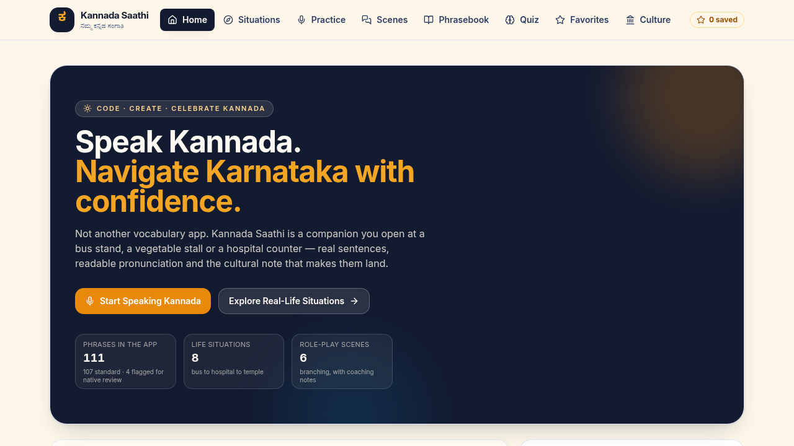
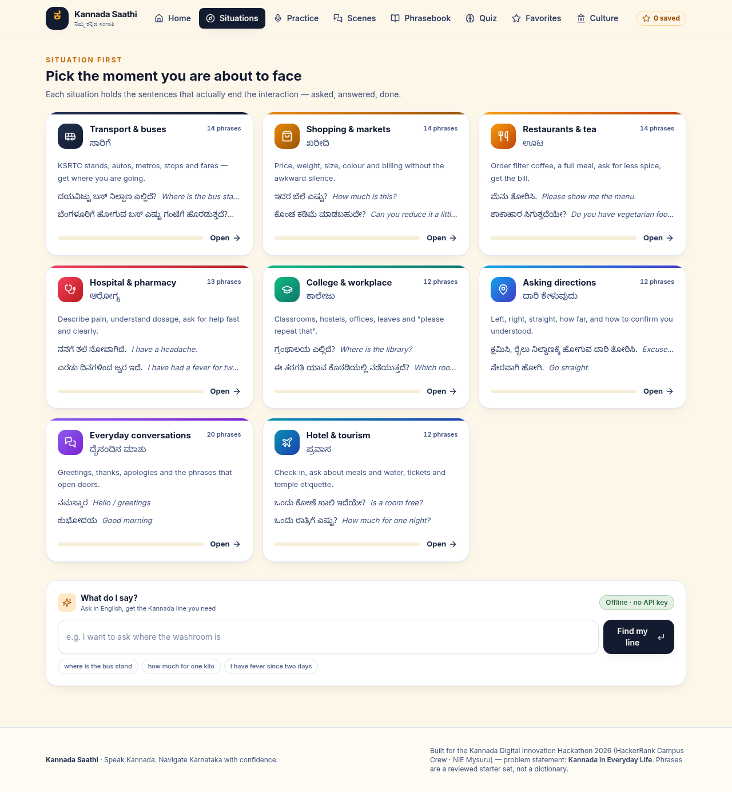
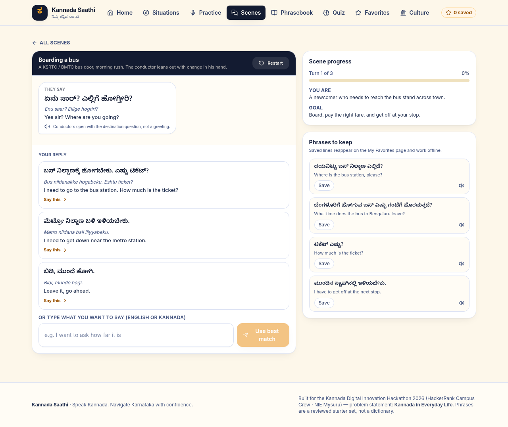
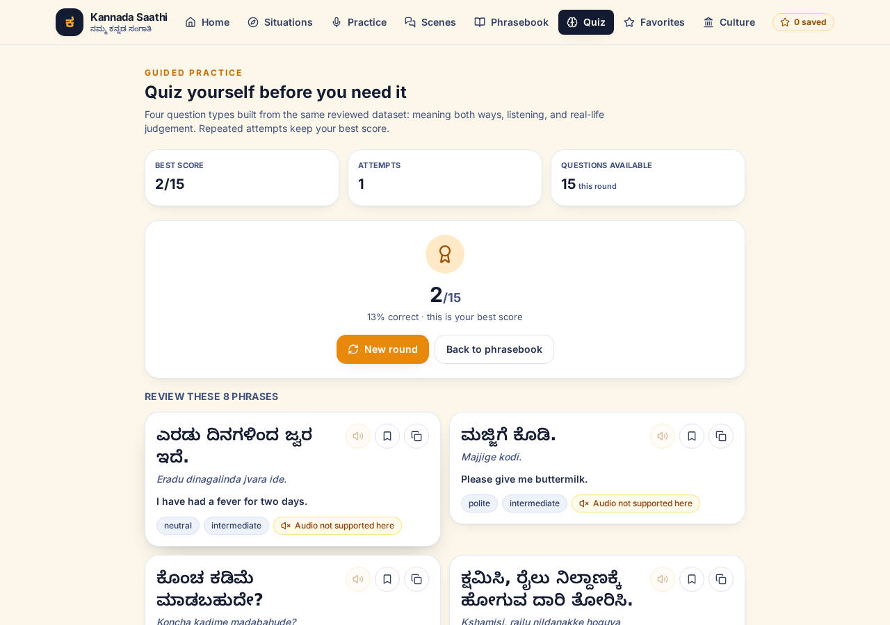
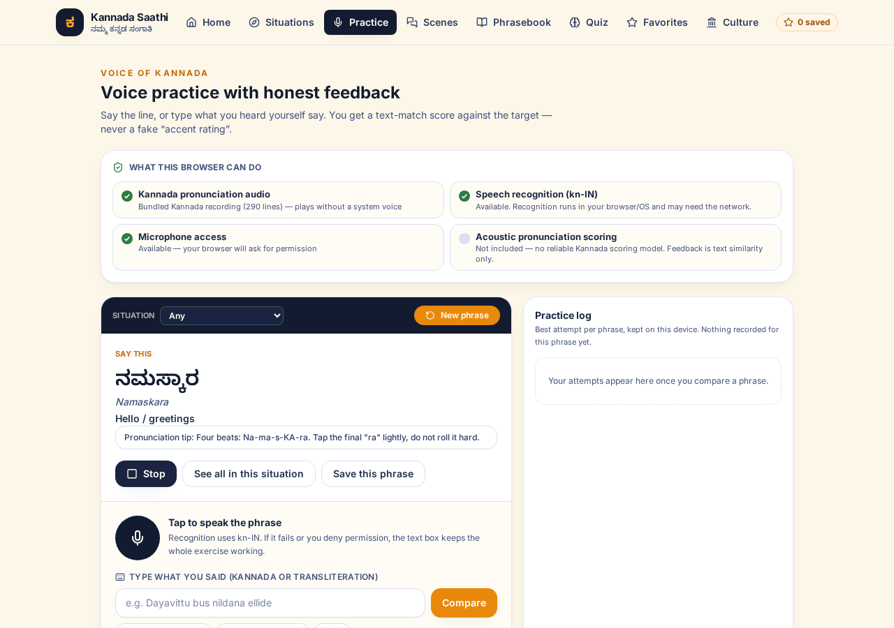
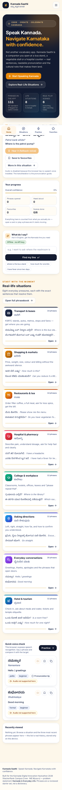
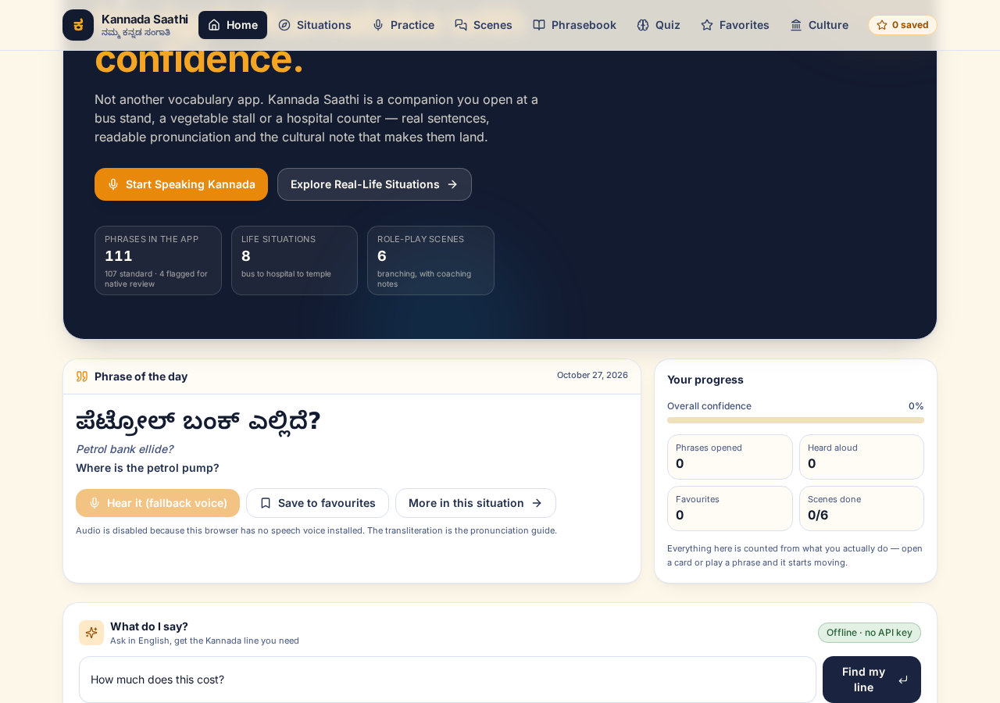
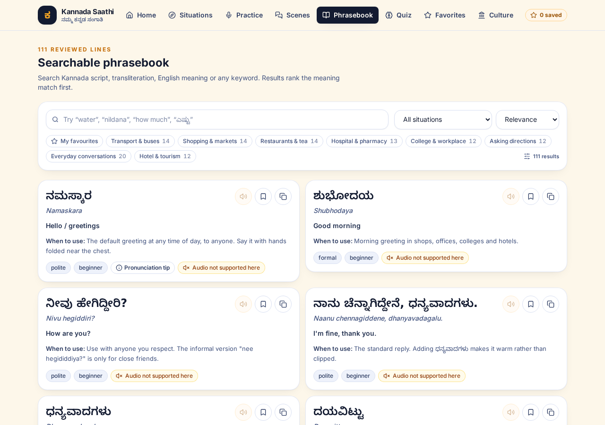
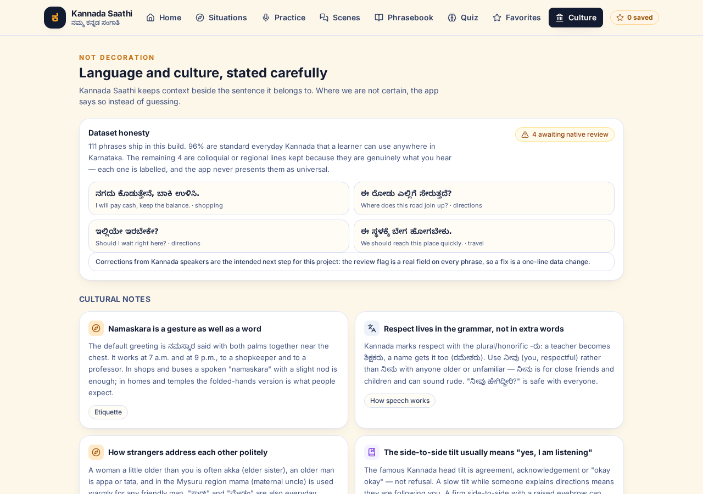

# Kannada Saathi — ಕನ್ನಡ ಸಾಥಿ

[](https://github.com/RANJITHROSAN17/Kannada-Digital/actions/workflows/ci.yml) [](https://github.com/RANJITHROSAN17/Kannada-Digital/actions/workflows/deploy.yml)

> **Speak Kannada. Navigate Karnataka with confidence.**
>
> An offline-first, mobile-first communication companion for non-Kannada speakers in Karnataka — built for the
> **Kannada Digital Innovation Hackathon 2026** (HackerRank Campus Crew · NIE Mysuru).
>
> **Problem statement chosen: #3 — Kannada in Everyday Life** (with #2 *Voice of Kannada* as a supporting capability).

> ✅ **Reviewed & hardened (27 Oct 2026):** the app now bundles its Kannada + Latin fonts, ships a real
> service worker / PWA manifest, uses a relative asset base that deploys anywhere, has exactly one `<h1>` per
> route, is gated by CI, and has **0 `npm audit` vulnerabilities** (all 17 Dependabot alerts resolved).
> Full findings and evidence: [`docs/REVIEW.md`](docs/REVIEW.md).
> Submission checklist: [`docs/SUBMISSION.md`](docs/SUBMISSION.md).

---

## 1. The problem, the users, the solution

**Problem.** People who arrive in Karnataka for a job, a college seat, a hospital visit or a holiday can usually
read English but cannot *say* anything useful in Kannada. Word-for-word translators give them nouns; what they
actually need is a sentence, its sound, and the social tone that makes it land. Public signage, bus conductors,
market vendors, pharmacy counters and government offices all run on spoken Kannada.

**Who is affected.** First-year students in Mysuru/Manipal/Bengaluru, transferred professionals, nurses and
paramedics, domestic workers, shop owners serving new customers, tourists at Hampi/Coorg/Gokarna, and anyone
accompanying a relative to a hospital appointment.

**Solution.** Kannada Saathi is organised **by the moment you are in**, not by vocabulary topic. Pick
*Bus & transport*, *Hospital & pharmacy* or *Buying vegetables*, and you get the exact sentences, in Kannada
script, with a reader-friendly transliteration, the English meaning, when to use it, audio where the browser can
provide it, and the cultural note that makes the sentence polite instead of blunt. Then rehearse it in a
branching role-play, and prove it to yourself in a quiz.

**Expected impact.** A learner who spends eight minutes in the app before stepping out can complete a real
transaction — ask a price, board a bus, confirm a dosage — without switching to English or waving a phone. The
starter set is reviewable and growable, so a native speaker can improve the app without touching code.

<table>
  <tr>
    <td><br><sub>Home · progress, streak, phrase of the day</sub></td>
    <td><br><sub>Situations · 8 cards with per-card progress</sub></td>
    <td><br><sub>Role-play · reply, coaching note, alternatives</sub></td>
  </tr>
  <tr>
    <td><br><sub>Quiz · score, best kept, misses as review cards</sub></td>
    <td><br><sub>Voice practice · capability report + typed fallback</sub></td>
    <td><br><sub>390 px · bottom tab bar</sub></td>
  </tr>
  <tr>
    <td><br><sub>Offline "what do I say?" assistant · no API key</sub></td>
    <td><br><sub>Searchable phrasebook · 111 reviewed lines</sub></td>
    <td><br><sub>Culture notes · politeness and register</sub></td>
  </tr>
</table>

---

## 2. Run it

Requires **Node 20.19+ or Node 22.12+** (Vite 8 requirement; Node 22 is used in CI). No backend, no API key, no account.

```bash
npm install          # once
npm run dev          # http://localhost:5173  (dev server, HMR)
```

Other commands:

```bash
npm run build        # type-check (tsc --noEmit) + production bundle into dist/
npm run preview      # serve the built dist/ locally on :4173
npm run typecheck    # tsc --noEmit only
npm test             # vitest run  (80 tests, incl. dataset-integrity tests)
npm audit            # 0 vulnerabilities (also enforced in CI)
npm run test:watch   # watch mode
```

Verified in this repo after the security upgrade: `npm run typecheck` → 0 errors · `npm test` → **7 files / 80
tests passed** · `npm run build` → `dist/` 391 kB JS (119 kB gzipped) + 37 kB CSS (7 kB gzipped) + 89 kB Kannada
font + 48 kB Inter font · `npm audit` → **0 vulnerabilities** · real Chromium at 1280 px and 390 px with **0
console / page / request errors**, a full quiz
round reaching the result screen, favourites surviving a reload, the offline assistant returning the right phrase,
voice typed scoring, and `document.fonts.check(...)` confirming both bundled faces load. All 12 screenshots in
`docs/screenshots/` were recaptured from this build.

### Deploy it (for the "live URL" deliverable)

The app uses `HashRouter`, so **any static host works with zero rewrite rules** — including a sub-path.

| Host | What to do |
| --- | --- |
| **GitHub Pages** | Push to `main`; the included workflow runs typecheck + tests + build and deploys. Enable *Settings → Pages → Source: GitHub Actions* once. **No env var needed** — the relative asset base handles the `/<repo>/` sub-path. |
| **Netlify / Vercel** | Build command `npm run build`, publish directory `dist`. No env vars needed. |
| **College LAN / any nginx** | `npm run build` and copy `dist/` into the web root. |

A ready-made workflow lives in [`.github/workflows/deploy.yml`](.github/workflows/deploy.yml), and
[`.github/workflows/ci.yml`](.github/workflows/ci.yml) runs the same checks on every push and pull request.

### What the engineering review changed

| Fix | Why it matters for a live demo |
| --- | --- |
| Bundled `Noto Sans Kannada` + `Inter` woff2 locally (`src/assets/`), removed the Google Fonts `<link>` and added `Saathi Kannada` to both Tailwind font stacks | Kannada rendered as empty boxes on Linux/container machines with no system Kannada font, and the external request broke offline use. Now verified: `document.fonts.check()` is `true`, zero external requests. |
| Added `public/manifest.webmanifest` + `public/sw.js` (registered in production only) | The README claimed "offline-first"; there was no service worker. The app shell is now cached and installable. |
| Default `base: './'` in `vite.config.ts` + `HashRouter` | One `dist/` works at a domain root, a GitHub Pages sub-path, Netlify, or a plain folder — no `VITE_BASE_PATH` juggling. |
| `SectionHeading` gained a `level` prop; each route now has exactly one `<h1>` | Screen readers and heading navigation previously started at `<h2>` on 7 of 10 routes. |
| Added `ci.yml` (with an `npm audit` gate) and `configure-pages` in `deploy.yml`; upgraded to React Router 7 | CI gates every push; the router major upgrade removed the future-flag warnings at the source. |
| Added `docs/REVIEW.md`, `docs/SUBMISSION.md`, refreshed screenshots and font licences | Judges get an evidence-backed review, a submission checklist and images that exist. |

See [`docs/REVIEW.md`](docs/REVIEW.md) for the full severity-ranked findings, verification evidence and the
remaining recommendations and the full Dependabot remediation log.

---

## 3. Features (and where each one lives)

| Feature | Route | What actually works |
| --- | --- | --- |
| **A. Situation-based assistant** | `/situations`, `/situations/:id` | 8 situations, **111 phrases**, each with Kannada script · transliteration · English meaning · "when to use" · pronunciation tip · play · copy · bookmark. |
| **B. Voice & pronunciation practice** | `/practice` | Capability dashboard that reports the truth for this browser; mic via `SpeechRecognition` (`kn-IN`); typed fallback; text-similarity match; per-phrase practice log. |
| **C. Conversation simulator** | `/conversations`, `/conversations/:id` | 6 branching role-plays (bus conductor, vegetable market, tea shop, clinic, auto ride, hotel check-in). Every reply carries a coaching note, `risky` options are explained rather than failed, alternatives are offered, and free text resolves against the real dataset. |
| **D. Searchable phrasebook** | `/phrasebook`, `/favorites` | Ranked search over script + transliteration + meaning + keywords, situation filter, favourites-only filter, sort modes, recently-viewed, favourites persisted in `localStorage`. |
| **E. Learning & quiz** | `/quiz` | 12 curated judgement questions + generator that builds meaning questions from the dataset; 4 types (`en→kn`, `kn→en`, scenario, listening); a pair-matching round; immediate feedback; best score kept, every attempt counted; missed phrases re-appear as review cards. |
| **F. Regional & cultural context** | `/culture`, inside each situation | 10 cultural notes, a regional-variant table where **every row is explicitly labelled as awaiting native review**, numbers/digits reference, and a public statement of the dataset's review status. |
| **"What do I say?" assistant** | home, situations | Ask in English, get ranked Kannada lines. Runs entirely offline against the bundled data. |

### Deliberate non-claims

* No "pronunciation accuracy %" — there is no reliable Kannada acoustic model in the browser, so the app reports
  **text similarity** and says that in the UI and in the code (`pronunciationAssessmentSupported()` returns `false`).
* No fake streaks or seeded stats. Every number on the progress card is derived from recorded interactions
  (`src/utils/progress.ts`), and a brand-new user legitimately sees zeros.
* No invented dialects. Regional variants are marked `needs-native-review` and rendered with a warning chip.
* No dead buttons, placeholder pages or lorem text: unknown routes redirect home, and unknown situation/scene ids
  render an explicit "does not exist" state with a way back.

---

## 4. Architecture

```
                        ┌──────────────────────────────────────────────┐
                        │          React 18 + TypeScript (Vite)        │
                        │                                              │
  user ──► HashRouter ──►  Pages  (Home · Situations · Practice ·      │
                        │            Conversations · Phrasebook ·      │
                        │            Quiz · Favorites · Culture)       │
                        │                 │                            │
                        │                 ▼                            │
                        │   Components  PhraseCard · ScenarioCard ·    │
                        │               AskWhatToSayBox · ui.tsx ·     │
                        │               Layout (nav, mobile tabs)      │
                        │                 │                            │
                        │     ┌───────────┴────────────┐              │
                        │     ▼                          ▼              │
                        │  hooks/useProgress      hooks/useSpeech      │
                        │  (context + actions)    (capabilities,       │
                        │     │                    play / listen)      │
                        │     ▼                          │              │
                        │  services/storage.ts           │              │
                        │  (versioned localStorage,      │              │
                        │   streaks, best-score rules)   │              │
                        │                                ▼              │
                        │            Web Speech API (browser only)     │
                        │            speechSynthesis · SpeechRecognition
                        │                                               │
                        │  services/assistant.ts ── offline retrieval   │
                        │        │  (utils/search.ts over the dataset)  │
                        │        └─ optional: VITE_AI_PROXY_URL ──► your proxy
                        │                                               │
                        │  DATA (bundled, typed, tested)                │
                        │  data/phrases.ts · categories.ts ·            │
                        │        conversations.ts · culture.ts · quiz.ts│
                        └──────────────────────────────────────────────┘
```

**Data flow, in words.** The datasets are typed modules compiled into the bundle, so the first paint already has
content. UI components never mutate state directly: they call actions on `useProgress()`, which produces a new
`ProgressState`, and `services/storage.ts` writes it to a single versioned key
(`kannada-saathi:progress:v1`) — that is what makes favourites survive a refresh. Voice features read a capability
snapshot from `detectCapabilities()` and every code path returns a typed reason instead of throwing when the API is
missing. Search, the assistant and the practice comparison share one normalisation layer (`utils/text.ts`) so
transliteration quirks (`nildāṇa` vs `nildana`) do not break matching.

**Optional AI, isolated.** `services/assistant.ts` works offline by default. If — and only if — you set
`VITE_AI_PROXY_URL` to *your own* proxy, the same question is POSTed there and the reply is appended under a
"verify with a native speaker" warning; any proxy failure degrades to the offline answer with a visible note. No
provider key ever lives in the frontend, because `VITE_*` is inlined into shipped JS.

---

## 5. Project layout

```
src/
  components/   Layout.tsx · PhraseCard.tsx · ScenarioCard.tsx ·
                AskWhatToSayBox.tsx · ui.tsx · ErrorBoundary.tsx
  pages/        HomePage · SituationsPage · VoicePracticePage · ConversationsPage ·
                PhrasebookPage · QuizPage · FavoritesPage · CulturePage
  data/         phrases.ts (111) · categories.ts (8) · conversations.ts (6 scenes) ·
                culture.ts (10 notes + regional variants) · quiz.ts (12 curated + generator)
  services/     speech.ts · storage.ts · assistant.ts
  hooks/        useProgress.tsx · useSpeech.ts
  utils/        search.ts · text.ts · progress.ts · cn.ts
  types/        index.ts (Phrase, Category, ConversationScenario, QuizQuestion,
                ProgressState, CulturalNote, RegionalVariant, …)
  test/setup.ts
```

---

## 6. Dataset & review workflow (read this before trusting a phrase)

* **111 phrases** across 8 situations, written in standard everyday Kannada and short enough to be produced by a
  beginner under pressure. Request forms use the polite imperatives ಕೊಡಿ / ಮಾಡಿ / ಹೇಳಿ / ತೋರಿಸಿ; questions use
  ಎಷ್ಟು / ಎಲ್ಲಿದೆ / ಯಾವಾಗ / ಏನು.
* **107 are `verified-usage`** — safe, standard lines. **4 are `needs-native-review`** — colloquial or code-mixed
  lines people really say (e.g. writing "ಬಾಕಿ ಉಳಿಸಿ", "ಈ ರೋಡು ಎಲ್ಲಿಗೆ ಸೇರುತ್ತದೆ?"), kept because learners hear
  them, and badged in the UI so nobody mistakes them for the universal form.
* Transliteration is **reader-friendly, not academic**: no IAST diacritics, because the goal is to be understood at
  a counter, not to publish a grammar.
* The five dataset tests in `src/data/__tests__/dataset.test.ts` enforce structure: unique ids, ≥10 phrases per
  situation, Kannada script present, **no other Indic or CJK script mixed into a Kannada field**, lowercase
  keywords, every conversation edge resolving to a real node or `end`, quiz answer indices valid, generated quiz
  free of duplicate phrases and deterministic per seed. That is what catches the "LLM quietly produced a Telugu
  vowel sign" class of bug.
* **Known limitation:** this is a reviewed starter set, not a dictionary, and it was not produced by a Kannada
  medium textbook. Before public release it should be read through by a native speaker. `npm test` will tell you
  the moment an edit breaks the shape of the data. To fix a line, edit `src/data/phrases.ts` — no other file needs
  to change, and the phrase's id (used by favourites) stays the same.

---

## 7. Accessibility & responsiveness

* Kannada is marked `lang="kn"` with a dedicated font stack (`Saathi Kannada` → `Noto Sans Kannada` →
  `Tunga` → `Nirmala UI` → OS fallbacks). Both faces are bundled locally, so script renders with no network and
  no system Kannada font — verified in headless Chromium, including the header tagline.
* Every route now exposes exactly one `<h1>`; in-page sections remain `<h2>`.
* Skip link, visible focus rings, `role="search"`, `aria-pressed` on toggles, `aria-live` status regions for
  playback/recognition/quiz feedback, labelled form controls, keyboard-operable nav, and
  `prefers-reduced-motion` respected.
* Contrast: ink-800 on ivory (≈14:1), saffron-600/700 on ivory for accents; audio buttons carry text for the
  unsupported case instead of an icon alone.
* Layouts verified at 390 px (bottom tab bar) and 1280 px (full nav).

---

## 8. Known limitations (honest list)

1. **Kannada TTS is rare on desktop.** Chrome/Edge usually have no `kn-IN` voice, so playback falls back to the
   default voice and the UI states that the transliteration is the reliable guide. On Android, Google TTS often
   *does* have Kannada — the app detects and uses it.
2. **Speech recognition is browser-dependent and network-backed** in Chrome's implementation. Permission denial,
   `no-speech`, `audio-capture` and `network` errors each get their own message, and the typed path always works.
3. **No acoustic scoring** — text similarity only, labelled as such.
4. **Clipboard and mic need a secure context.** Opening the built app over plain `http://192.168.x.x` disables
   both; the app detects it (`secureContext`) and says so.
5. **111 phrases is a starter set**, not full coverage; the assistant can only answer from what is bundled (it
   says "nothing matches that yet" rather than inventing a line).
6. `needs-native-review` items and the regional table are **claims to verify**, not teaching material.

---

## 9. Tests

```
npm test
```

7 files / 80 tests: text normalisation, Levenshtein and similarity edges, search ranking + filters + favourites,
storage hydration and persistence, streak maths, best-score-vs-attempts behaviour, speech degradation in an
unsupported browser, `<PhraseCard>` behaviour (bookmark writes through to `localStorage`, tip disclosure, review
badge), and page behaviour for situations, phrasebook search, favourites after an unmount/remount, a full
conversation playthrough and quiz feedback — plus the dataset integrity suite described above.

---

## 10. Hackathon submission pack in this repo

| Deliverable | Where |
| --- | --- |
| Working app + source | this repo; `npm run dev` / `dist/` |
| README (setup, features, architecture, stack, limitations) | this file |
| Problem · users · solution · impact | §1 above + [`docs/PROJECT-SUMMARY.md`](docs/PROJECT-SUMMARY.md) |
| Presentation (PPTX, 13 slides, all six required sections) | [`docs/Kannada-Saathi-Hackathon-Presentation.pptx`](docs/Kannada-Saathi-Hackathon-Presentation.pptx) |
| Deck generator (rebuilds the PPTX; counts + slide text read live from `src/data`) | `python3 scripts/make_deck.py` — needs `pip install python-pptx` |
| Screenshots used by the deck and this README | [`docs/screenshots/`](docs/screenshots) (captured in Chromium at 1280 px and 390 px) |
| Presentation outline (if you prefer to build your own deck) | [`docs/PRESENTATION-OUTLINE.md`](docs/PRESENTATION-OUTLINE.md) |
| 2-minute live demo script + 3–5 minute video walkthrough script | [`docs/DEMO-SCRIPT.md`](docs/DEMO-SCRIPT.md) |
| Environment template | [`.env.example`](.env.example) (optional — the app needs nothing) |
| Engineering review (findings, fixes, verification evidence) | [`docs/REVIEW.md`](docs/REVIEW.md) |
| Unstop submission checklist + ready-to-paste description | [`docs/SUBMISSION.md`](docs/SUBMISSION.md) |
| CI + Pages workflows | [`.github/workflows/`](.github/workflows) |
| Offline PWA (manifest + service worker) | `public/manifest.webmanifest`, `public/sw.js` |
| Bundled font licences (SIL OFL 1.1) | [`docs/licenses/`](docs/licenses) |

---

## 11. Stack

React 18 · TypeScript 5.6 (strict) · Vite 8.3.5 · Tailwind CSS 3 · lucide-react · react-router-dom 7.18.4
(HashRouter) · Vitest 4.1.12 + Testing Library + jsdom. No state library, no CSS-in-JS, no backend, no runtime
data fetch. `npm audit` reports 0 vulnerabilities in both development and production dependency trees.

## 12. Licence & credit

Built as an individual hackathon entry. App code is MIT (see [`LICENSE`](LICENSE)). Bundled fonts —
Noto Sans Kannada and Inter — are licensed under the SIL Open Font License 1.1; copies are in
[`docs/licenses/`](docs/licenses). Phrase data is curated for everyday usability and should be reviewed by a
native speaker before redistribution as a reference. Emergency numbers cited in the app (112 all-India emergency,
108 ambulance in Karnataka) should be confirmed against current local services before use.
