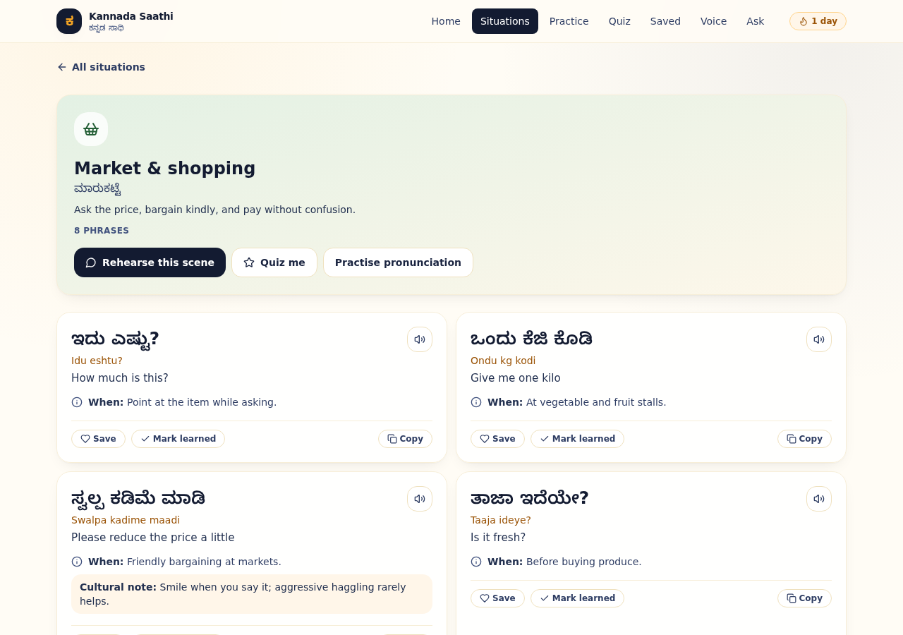
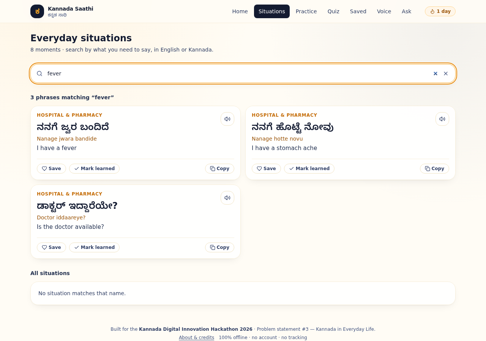
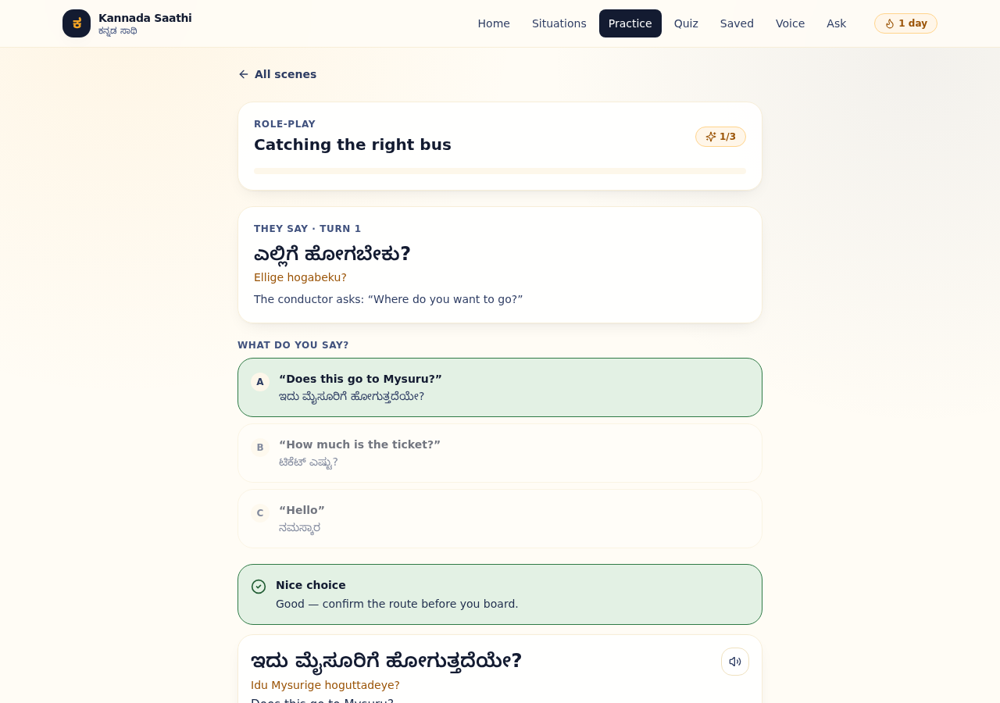
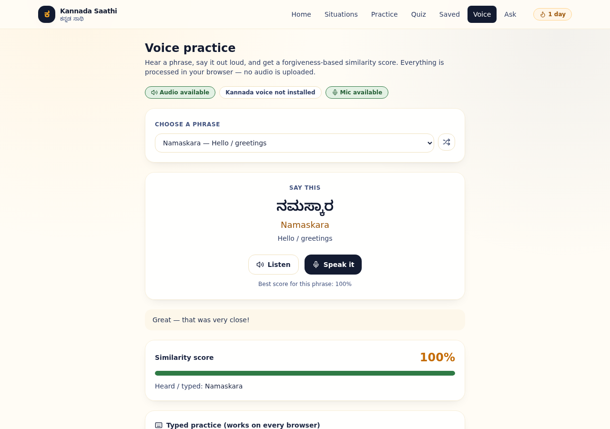

# Kannada Saathi — ಕನ್ನಡ ಸಾಥಿ

> **Speak Kannada. Navigate Karnataka with confidence.**
>
> An offline-first, mobile-first communication companion for people who have just
> arrived in Karnataka. Built for the **Kannada Digital Innovation Hackathon 2026**
> (HackerRank Campus Crew · NIE Mysuru).
>
> **Problem statement chosen: #3 — Kannada in Everyday Life**
> (with #1 *Kannada for Everyone* and #2 *Voice of Kannada* as supporting capabilities).

[](https://github.com/RANJITHROSAN17/Kannada-Digital/actions/workflows/ci.yml)
`React 18` · `TypeScript (strict)` · `Vite 5` · `Tailwind CSS` · `Vitest` · `PWA` · **no backend**

---

## 1. The problem, the users, the solution

**Problem.** People who arrive in Karnataka for a job, a college seat, a hospital visit or a
holiday can usually read English but cannot *say* anything useful in Kannada. Word-for-word
translators give them nouns; what they actually need is a sentence, its sound, and the social
tone that makes it land. Bus conductors, market vendors, pharmacy counters and canteens all
run on spoken Kannada.

**Who is affected.** First-year students in Mysuru/Manipal/Bengaluru, transferred professionals,
nurses and paramedics, domestic workers, shop owners serving new customers, tourists at
Hampi/Coorg/Gokarna, and anyone accompanying a relative to a hospital appointment.

**Solution.** Kannada Saathi is organised **by the moment you are in**, not by vocabulary topic.
Pick *Bus & transport*, *Hospital & pharmacy* or *Market & shopping*, and you get the exact
sentence in Kannada script, a readable transliteration, the English meaning, when to use it,
browser audio, and the cultural note that makes it polite instead of blunt. Then rehearse it in
a branching role-play, say it out loud, and prove it in a quiz.

**Expected impact.** A learner who spends eight minutes in the app before stepping out can
complete a real transaction — ask a price, board a bus, confirm a dosage — without switching
to English. The content is one reviewable TypeScript file, so a native speaker can improve the
app without touching any UI code.

---

## 2. See it

| Home · progress + phrase of the day | Situations · 8 cards with per-card progress | A situation · phrase cards with audio |
|---|---|---|
|  |  |  |

| Search in English or Kannada | Offline "Ask in English" assistant | Role-play with coaching feedback |
|---|---|---|
|  |  |  |

| Quiz result + review cards | Voice practice similarity score | Mobile · 390 px, bottom tab bar |
|---|---|---|
|  |  |  |

All screenshots were captured from a real headless Chromium at 1280 px and 390 px with
**0 console errors** — see [`docs/REVIEW.md`](docs/REVIEW.md).

---

## 3. Features

| Feature | What it does |
|---|---|
| **8 everyday situations** | First words, transport, market, health, food, directions, college/work, emergency — 64 curated phrases. |
| **Kannada that always renders** | Noto Sans Kannada is bundled locally (89 KB woff2), so script displays even on machines with no Kannada font and no internet. |
| **Phrase cards** | Kannada script, plain-ASCII transliteration, English meaning, "when to say it", cultural notes, audio, copy, save, mark learned. |
| **Search** | Free-text search across Kannada script, transliteration, English and tags. |
| **Ask in English** | Describe a need ("how much is this?") and get the right sentence from 13 offline intents — no API key, no network. |
| **Role-play** | 4 branching scenes (bus, market, pharmacy, college) with per-choice coaching feedback. |
| **Quiz** | 6 meaning questions + a 5-pair matching round, scoring, personal best and review of misses. |
| **Voice practice** | Browser text-to-speech (`kn-IN`) + speech recognition with a typed fallback and a forgiveness-based similarity score. |
| **Progress** | Daily streak, favourites, learned phrases, quiz attempts and best scores — all in `localStorage`. |
| **Offline PWA** | Service worker caches the app shell; installable via `manifest.webmanifest`. |
| **Accessibility** | Semantic landmarks, labelled controls, visible focus rings, `prefers-reduced-motion` support, 390 px layout with no horizontal overflow. |

---

## 4. Run it — right now

Requires **Node 18+**. No backend, no API key, no account, no `.env`.

```bash
npm install          # once
npm run dev          # http://localhost:5173
```

| Command | Purpose |
|---|---|
| `npm run dev` | Dev server with HMR (bound to `0.0.0.0` for tunnel/container demos). |
| `npm run typecheck` | `tsc --noEmit`, strict mode, zero errors. |
| `npm test` | Vitest — **93 tests across 7 files**. |
| `npm run build` | Typecheck + production bundle into `dist/`. |
| `npm run preview` | Serve the built `dist/` on port 4173. |

### Verified in this repository

```text
npm run typecheck   → 0 errors (strict, noUnusedLocals, noUnusedParameters)
npm test            → 93 passed (7 files) in ~6 s
npm run build       → 260 KB JS (81 KB gzip) + 29 KB CSS + 89 KB bundled Kannada font
Chromium smoke test → 10 routes + search, ask, quiz, role-play, voice, persistence
                    → 0 console errors, 0 page errors
Mobile 390 px       → scrollWidth 390 px (no horizontal overflow)
Full quiz flow      → 100% result written to localStorage and surviving a reload
```

---

## 5. Deploy it (for the "live URL" deliverable)

The build uses a **relative asset base** and `HashRouter`, so one `dist/` folder works on any
static host — domain root, GitHub Pages sub-path, or a folder on a college LAN — with **zero
rewrite rules**.

| Host | What to do |
|---|---|
| **GitHub Pages** | Push to `main`. The included workflow `.github/workflows/deploy-pages.yml` builds and deploys automatically. Enable *Settings → Pages → Source: GitHub Actions* once. |
| **Netlify / Vercel** | Import the repo; build command `npm run build`, publish directory `dist`. `netlify.toml` is already configured. |
| **Any static folder / nginx** | `npm run build`, then copy `dist/` into the web root. |

`VITE_BASE_PATH` in `.env.local` is available for unusual hosts, but is **not needed** for any
of the above (see `.env.example`).

---

## 6. How it works

```
src/data/phrases.ts   ── 64 phrases, 8 situations, 10 numerals (single source of truth)
src/data/scenes.ts    ── 4 role-play scenes referencing phrase ids
        │
        ├── src/lib/search.ts   ── 13 intents + weighted ranking → offline assistant
        ├── src/lib/quiz.ts     ── seeded question/pair generation + scoring
        ├── src/lib/speech.ts   ── Web Speech API + normalisation + Levenshtein similarity
        └── src/lib/storage.ts  ── typed localStorage progress + daily streak
        │
src/components/       ── shared PhraseCard, SituationCard, icons, progress context
src/pages/            ── Home, Situations, Detail, Practice, Quiz, Voice, Ask, Saved, About
        │
React Router (hash) → Vite build → static dist/ + service worker (+ bundled Kannada font)
```

There is no server component. All computation happens in the browser. See
[`docs/ARCHITECTURE.md`](docs/ARCHITECTURE.md) for the rationale behind each decision.

---

## 7. Offline, privacy and content

- **Offline:** all data is bundled; `public/sw.js` caches the app shell after the first visit.
- **Private:** progress never leaves `localStorage`; speech is handled by the browser and no
  recording is stored or uploaded. No analytics, no cookies, no external fonts or scripts.
- **Content:** hand-curated starter dataset. Transliteration is intentionally plain ASCII so a
  beginner can read it aloud; it is a learning aid, not a formal ISO transliteration. A native
  speaker can review and extend `src/data/phrases.ts` — dataset-integrity tests guard the format.
- **Font licence:** Noto Sans Kannada, SIL Open Font License 1.1 —
  [`docs/licenses/OFL-NotoSansKannada.txt`](docs/licenses/OFL-NotoSansKannada.txt).
- **App licence:** MIT — [`LICENSE`](LICENSE).

---

## 8. Documentation for judges

| Document | What it contains |
|---|---|
| [`docs/REVIEW.md`](docs/REVIEW.md) | Full engineering review of the repository: what was broken, severity-ranked findings, fixes applied, verification evidence, remaining recommendations. |
| [`docs/ARCHITECTURE.md`](docs/ARCHITECTURE.md) | System design, module map, key decisions and how to extend the dataset. |
| [`docs/DEMO.md`](docs/DEMO.md) | 3-minute judged demo script (exact clicks + talking points) and a 30-second version. |
| [`docs/SUBMISSION.md`](docs/SUBMISSION.md) | Unstop submission checklist, ready-to-paste abstract, feature list, tech stack and video script. |

---

## 9. Credits

Built for the **Kannada Digital Innovation Hackathon 2026** · *Code. Create. Celebrate Kannada.* ·
organised by HackerRank Campus Crew, The National Institute of Engineering (NIE), Mysuru in
collaboration with Adaption Labs.

Kannada content is a curated starter set; pronunciation guidance is provided by the device's
own speech engine. Font: Noto Sans Kannada (SIL OFL 1.1). Icons: Lucide (ISC).
